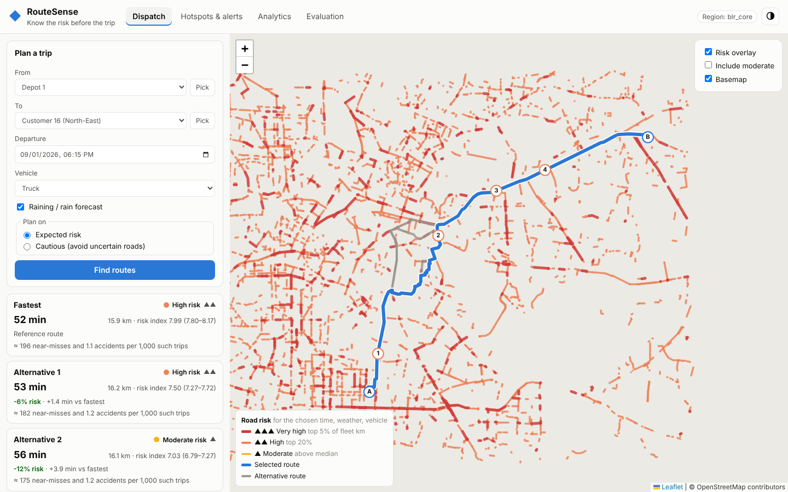

# RouteSense: Fleet Route Risk Intelligence

Route risk intelligence for delivery fleets, built and tested on real Bengaluru roads.
**Know the risk before the trip.** Before dispatch, RouteSense scores each candidate route, explains why it is risky,
suggests safer alternatives with their cost in minutes, and recommends a safer departure time.

**Live demo:** https://routesense-vsaiv.azurewebsites.net



## What is built

| Component | Implementation |
|---|---|
| Data preprocessing | `ingest/osm.py` (OSM road segments + features), `ingest/weather.py` (Open-Meteo), `sim/` (fleet telematics simulator on real roads with ground truth) |
| Hotspot detection | `models/hotspots.py`: severity- and recency-weighted events at intersections and road links, normalised by traffic, clustered into zones |
| Route risk scoring + confidence | `models/risk.py`: Poisson gradient boosting on road features × conditions, plus an empirical-Bayes correction per road that gives a confidence band and a "little data" flag |
| Safer alternatives | `routing/engine.py`: Pareto-optimal time/risk routes with an explicit recommendation policy, optional "cautious" mode that avoids uncertain roads |
| Visualisation | `web/`: risk overlay, highlighted hazards on the route, departure-time chart |
| Dispatch integration | `api/app.py`: dispatcher API, trip assignment log (SQLite) with post-trip outcomes |
| Analytics + reporting | `analytics.py`: weekly trends by road class, area, route, vehicle type, driver cohort and time slot; searchable hotspots |
| Performance evaluation | `evaluation.py`: temporal backtest vs baselines, ground-truth recovery, trip AUC + calibration, impact scored with true rates, timings |

Differentiators: **departure-time advisor**, **explained risk + AI driver briefing** (English/Hindi/Kannada via a free
open-weight LLM on Groq, template fallback), **emerging hotspot alerts**, **uncertainty-aware routing**, **impact estimate**.

## Setup

```bash
cd routesense
python -m venv .venv && source .venv/bin/activate
pip install -r requirements.txt && pip install -e .
pytest -q                     # 74 tests, about 1 min, no network needed
```

## Run

### With real Bengaluru data
Only the download needs internet access, to `overpass-api.de` and `archive-api.open-meteo.com`.

```bash
python scripts/run_region.py --region blr_core   # download -> simulate -> build -> evaluate (~10-20 min)
python scripts/serve.py --region blr_core        # http://127.0.0.1:8000
```

`run_region.py` writes a summary to `reports/blr_core/report.md` (tracked in git) and copies the downloaded roads and
weather to `snapshots/blr_core/`. To download on one machine and compute on another:

```bash
python scripts/run_region.py --region blr_core --download-only
git add snapshots/blr_core && git commit -m "Add Bengaluru roads and weather snapshot" && git push
```

The individual steps are also available: `feasibility_check.py`, `simulate.py`, `build.py`, `evaluate.py`.

### Offline, with the synthetic dev city
```bash
python scripts/make_dev_data.py
python scripts/build.py --region dev_city
python scripts/evaluate.py --region dev_city
python scripts/serve.py --region dev_city
```

### AI driver briefings (optional)
Briefings in English, Hindi or Kannada are written by an open-weight LLM on Groq's free API (no credit card):
create a key at console.groq.com and set `GROQ_API_KEY` before `serve.py`. The default model is `openai/gpt-oss-120b`
(about 1,000 free requests a day); override it with `ROUTESENSE_LLM_MODEL`. Without a key, or when the free quota or
rate limit is hit, a deterministic English template is used. The hazards themselves always come from our models.

## Deploy a public demo (Azure for Students)

The server needs about 650 MB of RAM, more than free no-card hosts offer (512 MB, 0.1 CPU), and Hugging Face
now requires PRO for Docker Spaces. It runs on Azure App Service (Linux, plan B1: 1 core, 1.75 GB, always on,
about US$13 a month), paid from the Azure for Students credit (US$100, no credit card). The model is built on
your machine and uploaded with the code; Azure installs the Python packages itself, so Docker is not needed.

1. Activate Azure for Students at azure.microsoft.com/free/students with your college email.
2. Install the Azure CLI (Windows: `winget install --exact --id Microsoft.AzureCLI`, then open a new terminal).
3. Build the model once if `data/processed/blr_core/artifacts/` does not exist yet, then package the app:
   ```bash
   python scripts/run_region.py --region blr_core       # 10-20 min, about 4.5 GB RAM
   python scripts/package_azure.py                      # -> dist/routesense-azure.zip
   ```
4. Create the app and deploy (pick a unique `<app-name>`; use the Python version `package_azure.py` printed):
   ```bash
   az login
   az group create --name routesense-rg --location centralindia
   az appservice plan create --resource-group routesense-rg --name routesense-plan --is-linux --sku B1
   az webapp create --resource-group routesense-rg --plan routesense-plan --name <app-name> --runtime "PYTHON:3.12"
   az webapp config appsettings set --resource-group routesense-rg --name <app-name> --settings SCM_DO_BUILD_DURING_DEPLOYMENT=true ROUTESENSE_REGION_DIR=data/processed/blr_core ROUTESENSE_LLM_DAILY_LIMIT=300 WEBSITES_CONTAINER_START_TIME_LIMIT=600
   az webapp config set --resource-group routesense-rg --name <app-name> --always-on true --startup-file "python -m uvicorn routesense.api.app:app_from_env --factory --host 0.0.0.0 --port 8000"
   az webapp deploy --resource-group routesense-rg --name <app-name> --src-path dist/routesense-azure.zip --type zip
   ```
5. Open the address that `az webapp create` printed as `defaultHostName`. To redeploy, repeat step 3's
   `package_azure.py` and the last command of step 4.

Notes:
- AI briefings: in the Azure portal, open the app → Settings → Environment variables, add `GROQ_API_KEY`
  and apply. Requests are capped at `ROUTESENSE_LLM_DAILY_LIMIT` per day to stay inside Groq's free quota;
  over the cap, the template briefing is used.
- The dispatch log lives in SQLite on the server and resets on restarts and redeploys.
- When the demo is no longer needed, stop the charges with `az group delete --name routesense-rg`.
- Any Docker host can run the app instead: `docker build -t routesense . && docker run -p 7860:7860 routesense`
  (the image builds the model itself from `snapshots/blr_core/`).

## Results: central/east Bengaluru (real roads and weather, simulated fleet)

Region `blr_core` (77.55–77.70 E, 12.90–13.02 N): 129,261 OSM road segments, hourly weather for Mar–Aug 2026,
a simulated fleet of 120 vehicles (110,284 trips, 1.09 million km). Trained on Mar–Jun, tested on Jul–Aug.
Full report: [reports/blr_core/report.md](reports/blr_core/report.md).

| Measure | Result |
|---|---|
| Serious events (near-miss + accident) avoided, scored with the simulator's **true** rates | **13.8%** of all trips, 20.1% on rerouted trips (129 per 10,000 trips) |
| Cost | +2.6 min per rerouted trip (7.2% total travel time), 67% of trips rerouted |
| Riskiest 10% of driven km | 2.16× the average serious-event rate |
| Trip risk AUC (serious event on the trip) | 0.675 (distance alone 0.631) |
| Road level, deviance explained | full model 0.115 vs raw history 0.058 vs road features alone −0.021 |
| Agreement with hidden true risk (Spearman) | near-miss 0.35 (raw history 0.25), harsh 0.74 (raw history 0.68) |
| Emerging hotspots | 14 of 24 injected hazards (13 of 19 at junctions with 100+ fleet passes in 2 weeks), median 10.5 days, 1.35 false-alarm junction areas per week |
| Speed | ~100 ms for all route options; model fit 33 s; full pipeline ~7 min |

What real roads changed (fixed before these numbers): OSM splits junctions into very short segments (58 m on average),
so hazards and alerts work on 75 m junction zones; speed limits are rarely tagged, so routing uses class-based Bengaluru
free-flow speeds; and the feature model is cross-fitted so it cannot memorise individual roads. Only 3.6% of segments carry
a lighting tag, so lighting is mostly unknown; satellite night lights are the planned fix.

The synthetic dev city (`dev_city`) gives similar figures and is only for development.

## Data provenance

| Data | Source | Real or simulated |
|---|---|---|
| Road network and road attributes | OpenStreetMap (via OSMnx) | Real |
| Hourly weather | Open-Meteo archive | Real |
| Telematics events, trips | `routesense/sim` | **Simulated** on the real roads and weather |
| Dev city (`dev_city`) | `routesense/devcity.py` | **Synthetic** roads and weather, for development only |

Every simulator assumption is listed in `routesense/sim/params.py`; calibrate against MoRTH *Road Accidents in India*
using `calibration_report`. The simulator keeps the true per-road risk and the injected emerging hazards, so every
model is scored against ground truth. The same pipeline accepts real telematics in the same schema (`schema.py`).

## Layout

```
routesense/
  config.py, schema.py      regions, paths, table contracts
  ingest/                   OSM segments + features, Open-Meteo weather
  sim/                      fleet simulator (params = documented assumptions)
  devcity.py                synthetic dev city
  models/                   hotspots, risk model, emerging-hotspot detection
  routing/engine.py         scoring, alternatives, departure advisor
  explain.py, briefing.py   reasons per road, driver briefing (Groq LLM / template)
  analytics.py              weekly trend reporting
  evaluation.py             backtest + impact
  pipeline.py               build serving artifacts
  api/app.py                FastAPI service
web/                        dispatcher UI (Leaflet + Chart.js vendored, works offline)
scripts/                    entry points
tests/                      pytest (synthetic fixtures, no network)
```
